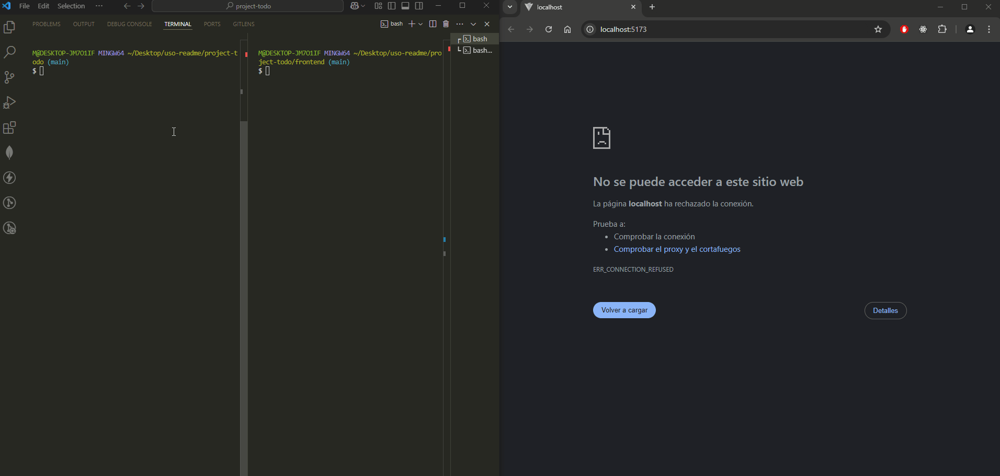

# CRUD API with MongoDB, ExpressJS, NodeJS & React

## About Project

Simple application that performs CRUD operations on Teachers information.

> _This project started with learning purposes on various topics: Express, REST API's, Front-end Frameworks (React Bootstrap) ... how to structure folders, and even how to add a demo GIF to this README.md file. This is why includes examples about "Members" or "Dogs" or "birds" (Found in tutorials, blogs, or official documentation)._

> The following sections correspond to the "Teachers" Example

### Folder Structure Overview

```
.
├── config
│   └── db.js
├── controllers
│   └── teachersController.js
├── models
│   └── TeachersModel.js
├── routes
│   └── api
│       └── teachersRoutes.js
├── .env
└── frontend
    ├── src
    │   ├── components
    │   │   └── TeachersTable.jsx
    │   ├── pages
    │   │   └── HomePage.jsx
    │   ├── App.jsx
    │   └── main.jsx
    └── .env
```

### Path Overview:

- _Backend:_ `~/Desktop/project-todo`
- _Frontend:_ `~/Desktop/project-todo/frontend`

## Getting Started

### Installation

1. Clone the repo

```
    git clone https://github.com/mauriciorfdev/project-todo.git
```

2. Install NPM Packages (_On Backend & Frontend_)

```
npm install
```

3. Enter each API KEY (_.env_ file) for:

- **BACKEND**:

```
    MONGO_URI = <your string>
```

- **FRONTEND** ( _TeachersTable Component_ ):

```
    VITE_API_URL = http://localhost:5000/api/teachers
```

### Usage

- Navigate to the Root Directory (project-name)

1. Run the Backend Server: `npm run dev`

```
Server listen on port 5000...
Connected to MongoDB Atlas!
```

2. Change to the Frontend directory: `cd frontend` and then:
3. Run the Frontend Server: `npm run dev`

```
VITE v5.4.11  ready in 258 ms

  ➜  Local:   http://localhost:5173/
  ➜  Network: use --host to expose
  ➜  press h + enter to show help
```

#### _Usage Demo_



4.Test the API Endpoints using tools such as Postman or Thunder Client (VS Code Extension):

| Methods | Endpoint          | Actions                |
| ------- | ----------------- | ---------------------- |
| GET     | /api/teachers     | Get all teachers       |
| GET     | /api/teachers/:id | Get teacher by `id`    |
| POST    | /api/teachers     | Add new teacher        |
| PUT     | /api/teachers/:id | Update teacher by `id` |
| DELETE  | /api/teachers/:id | Remove teacher by `id` |
